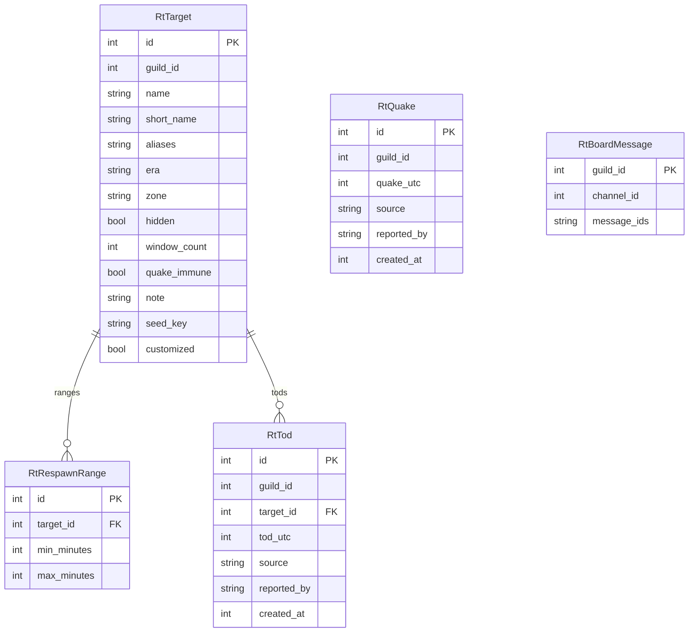

# Raid Timers Database Schema

> **Note:** This documentation is primarily AI-generated from the source code and may contain inaccuracies. Always verify behavior against the actual implementation.

Source: `roboToald/db/models/raid_timers.py`

## Entity Relationship Diagram

## Behavior

- Per-guild copy of the default P99 catalog (`roboToald/raidtargets/data/p99_targets_default.json`).
- Current ToD = highest `rt_tods.id` for `(guild_id, target_id)`.
- Last quake = highest `rt_quakes.id` for the guild.
- Window math: `roboToald/raidtargets/rt_windows.py` (PHP `targets-v2.json` port).
